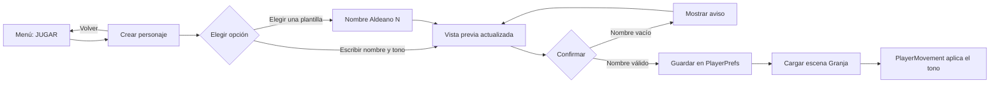
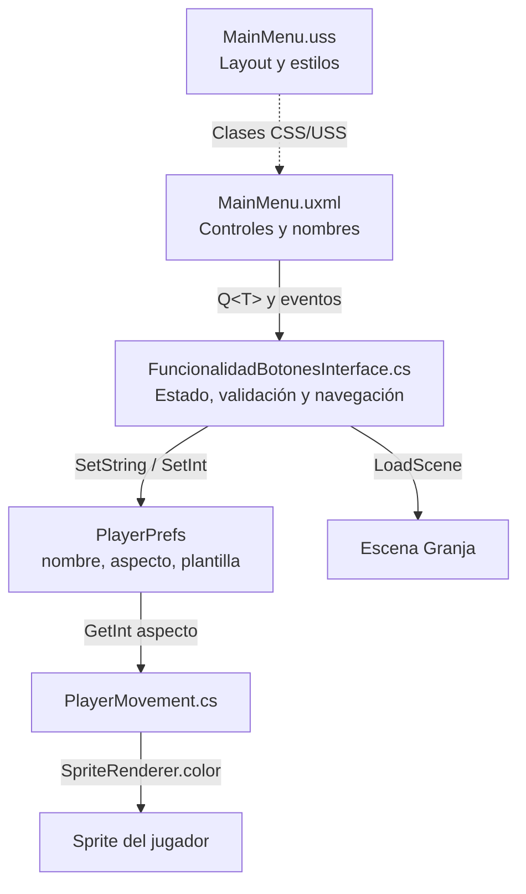

# Creación y selección de personajes

## Introducción

La pantalla de personaje se abre desde **JUGAR** en el menú principal. Está implementada sobre el sistema UI Toolkit de Moonveil y permite introducir un nombre, seleccionar uno de tres tonos de apariencia o elegir una de cinco plantillas provisionales antes de cargar la escena `Granja`.

## Objetivo

Incorporar un paso de selección previo a la partida sin rehacer las escenas ni añadir dependencias. La interfaz reutiliza el menú existente y el sprite actual del jugador; las cinco tarjetas dejan preparada una estructura ampliable para personajes y sprites futuros.

## Funcionamiento



1. `FuncionalidadBotonesInterface` se registra como callback de `PanelRenderer`. Cuando se crea la interfaz, el callback `cargaArchivo` busca los controles UXML por nombre (`Q<T>`), comprueba que existan y registra sus eventos.
2. Al pulsar **JUGAR**, `mostrarCreacionPersonaje` oculta `menu-content` y muestra `creation-screen` cambiando `style.display`.
3. `character-name` es un `TextField`. Su `RegisterValueChangedCallback` actualiza la vista previa y deselecciona las plantillas, porque el nombre puede dejar de corresponder al nombre provisional de una tarjeta.
4. Los botones `appearance-0` a `appearance-2` actualizan `aspectoSeleccionado`, cambian la clase USS `character-preview--N` y resaltan el botón seleccionado. Los índices corresponden a **Natural** (0), **Bosque** (1) y **Luna** (2).
5. Los cinco botones `btn-preset-0` a `btn-preset-4` llaman a `seleccionarPersonajePredeterminado`. Esta acción asigna el nombre provisional `Aldeano N`, restablece el aspecto a Natural, marca la tarjeta y guarda su índice en memoria para confirmarlo después. El jugador puede editar ese nombre.
6. **EMPEZAR AVENTURA** llama a `confirmarPersonaje`. El nombre se normaliza con `Trim()` y, si queda vacío, se muestra un error en `selection-status` y no se cambia de escena. En caso válido, se guardan nombre, aspecto e índice de plantilla, se llama a `PlayerPrefs.Save()` y después a `SceneManager.LoadScene(SceneVideojuego)`.
7. El método `Start` de `PlayerMovement` lee el índice de apariencia guardado y aplica el tinte al `SpriteRenderer`. **VOLVER** oculta la pantalla de creación y recupera el contenido del menú; no borra los valores de una partida anterior.

La vista previa se compone de un sprite de fondo definido en USS y etiquetas de texto. La vista previa se actualiza al cambiar el nombre o la apariencia. Seleccionar una plantilla establece su nombre de ejemplo, pero el elemento visual de la tarjeta y la vista previa usan actualmente el mismo sprite provisional.

### Comunicación entre componentes



## Diseño de la interfaz

El UXML mantiene la vista del menú principal y añade `creation-screen`, inicialmente oculta con `display: none`. La pantalla nueva dispone de:

- Una cabecera para la aventura.
- Un panel de vista previa y un formulario en disposición horizontal.
- Tres botones de apariencia.
- Una fila con cinco tarjetas seleccionables, cada una con un contenedor para el futuro retrato.
- Acciones para volver al menú o empezar la partida.

`MainMenu.uss` proporciona el fondo y la paleta azul-violeta del menú, el estilo de paneles y botones, los tonos de vista previa y la clase de borde que identifica una selección. La distribución está pensada para el formato amplio que usa actualmente el proyecto; no se ha probado su adaptación a todas las relaciones de aspecto.

## Estructura del código

| Archivo | Responsabilidad técnica |
|---|---|
| `Assets/UIElements/MainMenu.uxml` | Jerarquía de elementos UI Toolkit e identificadores consultados desde C#. Incluye las cinco tarjetas `btn-preset-0`…`btn-preset-4`. |
| `Assets/UIElements/MainMenu.uss` | Layout, dimensiones, colores, imagen provisional y clases visuales para los tres tonos y las selecciones. |
| `Assets/Scripts/Interface/FuncionalidadBotonesInterface.cs` | Registro de callbacks, consultas UXML, navegación entre vistas, estado de edición, validación, persistencia y carga de escena. |
| `Assets/Scripts/Granja/PlayerMovement.cs` | Lectura de la preferencia del tono al iniciar el jugador y asignación del color al `SpriteRenderer`. |
| `ProjectSettings/EditorBuildSettings.asset` | Registra `MenuScene` antes de `Granja`, para abrir primero el menú en una compilación. |
| `Prompts/CreacionPersonaje.md` | Copia de las instrucciones completas de la tarea. |

### Estado y persistencia

El controlador mantiene el aspecto y el índice de plantilla como estado temporal (`aspectoSeleccionado` y `personajePredeterminado`) mientras se configura el personaje. Al confirmar, escribe estos valores:

| Clave `PlayerPrefs` | Tipo | Valor guardado |
|---|---|---|
| `moonveil_personaje_nombre` | `string` | Nombre sin espacios iniciales ni finales. |
| `moonveil_personaje_aspecto` | `int` | Índice del tono: 0, 1 o 2. |
| `moonveil_personaje_predeterminado` | `int` | Índice de tarjeta: 0–4; `-1` si se creó desde cero o se editó el nombre tras seleccionar una tarjeta. |

`PlayerPrefs` guarda datos sencillos entre sesiones; no representa un modelo completo de personaje ni un guardado de partida. En esta implementación, `PlayerMovement` consume solamente `moonveil_personaje_aspecto`. El nombre y el índice se guardan, pero aún no se usan en la escena. La clave del aspecto está escrita también como literal en `PlayerMovement`; si se cambia, hay que mantener sincronizados ambos scripts.

### Correspondencia del aspecto

Los índices del controlador y de `PlayerMovement` deben conservar el mismo orden:

| Índice | Etiqueta | Color aproximado del sprite |
|---:|---|---|
| 0 | Natural | Blanco (color original del `SpriteRenderer`). |
| 1 | Bosque | Verde claro (`0.75, 0.92, 0.75`). |
| 2 | Luna | Azul claro (`0.76, 0.8, 1`). |

La vista previa tiene sus propios tintes USS; el jugador en la escena recibe colores C# mediante `SpriteRenderer.color`. Son dos representaciones equivalentes aproximadas, no sprites distintos.

### Diagrama del layout

```text
┌──────────────────────────── NUEVA AVENTURA ────────────────────────────┐
│ ┌──────── VISTA PREVIA ────────┐  ┌──── CREAR PERSONAJE ────────────┐ │
│ │ Sprite + nombre + tono       │  │ Nombre: [TextField]             │ │
│ │                              │  │ Aspecto: [Natural][Bosque][Luna]│ │
│ └──────────────────────────────┘  └─────────────────────────────────┘ │
│ PERSONAJES PREDETERMINADOS                                             │
│ [Plantilla 1] [Plantilla 2] [Plantilla 3] [Plantilla 4] [Plantilla 5] │
│                         [VOLVER] [EMPEZAR AVENTURA]                     │
└───────────────────────────────────────────────────────────────────────┘
```

## Personajes predeterminados

`MainMenu.uxml` define cinco `Button` con elementos `preset-portrait`, que sirven como espacios visuales para las imágenes futuras. El controlador crea un array de cinco referencias y registra una acción por índice. Actualmente, los rótulos son `PLANTILLA 1` a `PLANTILLA 5`, los retratos usan el sprite actual y los nombres `Aldeano 1` a `Aldeano 5` son datos de prueba. No se han creado personajes definitivos ni sus sprites.

Para incorporarlos, asigna un sprite y nombre a cada tarjeta y amplía `seleccionarPersonajePredeterminado` para cargar sus datos, o extrae dichos datos a una lista/objeto de configuración. Si se cambia el número de tarjetas, hay que coordinar el UXML, el array `botonesPredeterminados` (actualmente tamaño 5) y el rango de índices persistido.

## Tecnologías utilizadas

- Unity 6 y C#.
- UI Toolkit: UXML para la jerarquía, USS para estilos y `VisualElement`, `Button`, `TextField` y `Label` en tiempo de ejecución.
- `PanelRenderer.RegisterUIReloadCallback` para conectar los elementos cuando la vista está lista.
- `UnityEngine.SceneManagement.SceneManager` para cambiar a la granja.
- `PlayerPrefs` para persistir nombre, aspecto e índice de plantilla.
- No se añadieron paquetes ni dependencias.

## Comprobaciones y límites conocidos

- `dotnet build Assembly-CSharp.csproj --no-restore --verbosity quiet`: compilación correcta, cero errores. Se mostraron advertencias ya relacionadas con referencias del proyecto y APIs obsoletas de `PanelRenderer`.
- Se comprobó que `MainMenu.uxml` es XML bien formado, que contiene los controles necesarios y que hay cinco tarjetas de plantilla.
- No se ejecutó una prueba interactiva en Play Mode; por tanto, la interacción visual en Unity aún debe verificarse manualmente.
- Las plantillas son seleccionables, pero actualmente comparten una apariencia provisional y no representan cinco personajes con datos propios.
- La escena muestra el tono del sprite, pero no presenta el nombre ni consume el índice de plantilla.
- Se añadieron comentarios en C# alrededor del ciclo de vida del panel, la conexión de UXML, el registro de callbacks, la selección de tarjetas, la persistencia y el tinte del sprite.

## Posibles mejoras futuras

- Probar en Play Mode las transiciones, la validación del nombre y la aplicación del tono.
- Incorporar retratos y sprites finales, y definir datos propios para cada personaje.
- Consumir el nombre guardado en la interfaz de la granja.
- Evitar que las claves de preferencias estén duplicadas entre scripts mediante una clase compartida.
- Adaptar y probar el layout en resoluciones y relaciones de aspecto distintas.
